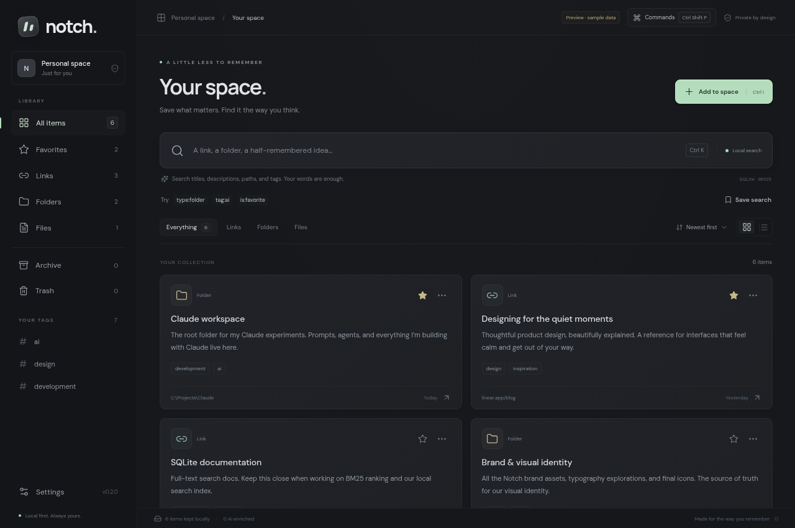
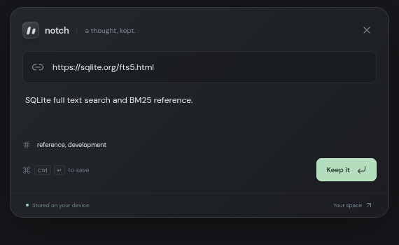
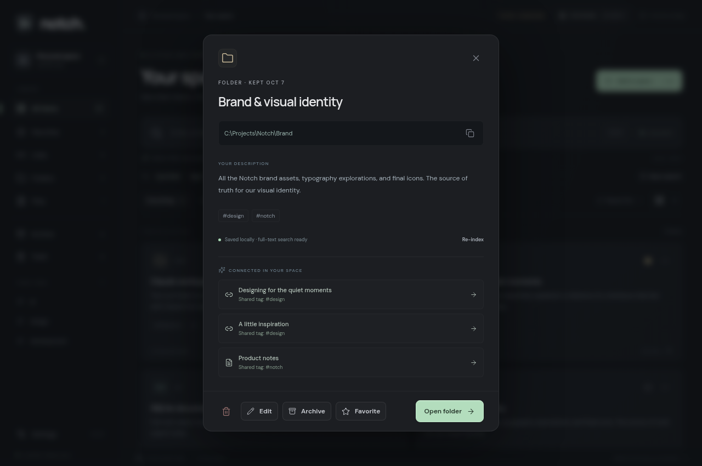

# Notch

A quiet, space gray Windows desktop app for keeping links, folder paths, and the words that make them findable.

Press **Ctrl + I** from any app, or click the tray icon, to open the small capture notch at the top of the current monitor. Paste a URL or absolute path, add a description, and press **Ctrl + Enter**. A green check confirms the local save. Open **Your space** to search, organize, and open what you kept.

For example, save `C:\Projects\Claude` with “This is my Claude root folder for agents and prompts.” Searching **claude root folder** returns that exact path. **Open folder** opens Explorer; **Copy** copies the full path. Files are revealed in Explorer rather than executed.

## Version 0.2.0

The [original 0.1.0 release](https://github.com/data-node/01a12515-452f-759f-96b9-413e3d043394/tree/v0.1.0) is frozen. New work is versioned separately. Read the [70-item improvement roadmap](docs/ROADMAP.md) and [0.2.0 release notes](docs/releases/0.2.0.md).

The control panel now includes editing, archive, recoverable trash with Undo/restore, named saved searches, a **Ctrl+Shift+P** command palette, connected items with visible reasons, and indexing health with retry. Try `claude type:folder tag:ai` or `is:favorite`. Editing lets you correct a dotted folder or extensionless file. User-written titles survive AI enrichment.

On upgrade, an existing v1 SQLite database is backed up before the atomic v2 migration. Do not open the upgraded library with the frozen old app; see the recovery instructions in the release notes.

## Run on Windows

Requirements: Windows 10/11 x64, **Node.js 24 LTS**, npm, and Git. No separate database or Python runtime is needed. Use the existing checkout; every cloud task is already isolated, so a Git worktree is unnecessary.

```powershell
npm ci
npm run dev
```

The development command compiles the Electron process and starts Vite and Electron together. React edits reload immediately. Restart `npm run dev` after changing Electron or shared backend code. Port **5173** must be available. The default **Ctrl + I** shortcut can conflict with another app; choose **Control+Shift+I** in Settings if needed. **Ctrl + K** focuses library search. Closing the control panel keeps Notch in the tray; choose **Quit Notch** from the tray menu to exit.

To run the production build locally:

```powershell
npm run build
npm start
```

Build a Windows installer:

```powershell
npm run package:win
```

Output is in `release/`. Build on Windows for the supported installer workflow. The installer is currently unsigned; public distribution should add Windows code signing. Windows Explorer, login startup, the global shortcut, and installation need a final check on a real Windows machine; Linux/browser validation cannot establish Windows behavior.

`npm run package:portable` builds a standalone Windows launcher without installation. The current cloud environment has no Wine, so an NSIS installer cannot be completed here. A portable build can be produced on Linux using `electron-builder --win portable --x64 --config.win.signAndEditExecutable=false` with writable Electron/build caches. This skips Windows executable metadata editing and code signing; prefer the normal Windows build for distribution. Start with Windows is available in packaged builds and uses the original portable launcher path when applicable.

## Download through GitHub

The initial portable build is available directly from the repository: **[Download Notch 0.1.0 for Windows](downloads/Notch-0.1.0-win-x64.exe?raw=1)**. This is the unsigned Linux cross-build described above and still needs execution testing on Windows. [Its SHA-256 checksum](downloads/Notch-0.1.0-win-x64.exe.sha256) is included beside it. Run the portable executable directly; installation is not required.

New versioned downloads are published on the [GitHub Releases page](https://github.com/data-node/01a12515-452f-759f-96b9-413e3d043394/releases). The Windows workflow builds both installer and portable app, exercises actual capture/search in the packaged runtime, creates SHA-256 files, and publishes assets only for validated version tags. Main-branch builds retain an Actions artifact for 14 days; release assets provide persistent public downloads. A failed build does not publish a release.

The first portable binary is preserved with the frozen source at [v0.1.0](https://github.com/data-node/01a12515-452f-759f-96b9-413e3d043394/raw/refs/tags/v0.1.0/downloads/Notch-0.1.0-win-x64.exe), independently of new workflow outcomes. Builds are currently unsigned. The workflow deliberately disables executable signing/metadata editing until a signing setup is available.

## Interface previews

The control panel preview uses clearly labeled browser sample data; a new desktop collection starts empty. The capture screenshot comes from the native Electron smoke run on Linux.







## AI and search

**Local only** is the default. Every capture is committed to SQLite before any network call. SQLite **FTS5**, Porter stemming, prefix matching, and weighted **BM25** search titles, paths, descriptions, summaries, tags, and related terms. No AI key is needed for capture or local search.

In **Settings → Intelligence**, choose:

- **Anthropic:** enter your API key and an exact model ID available to your account. The default is `claude-haiku-4-5-20251001`; the ID is editable, and the app does not assume a model called “Haiku 5.5” is available. On Windows, the key is encrypted using Electron safeStorage/Windows DPAPI and is never returned to the renderer or included in an export. If encrypted key storage is unavailable, set `NOTCH_ANTHROPIC_API_KEY` before launching instead. The description and locator are sent to Anthropic only when enabled; API costs apply.
- **Ollama:** install [Ollama](https://ollama.com), run `ollama pull qwen3:4b`, and ensure its server is running at `http://127.0.0.1:11434`. Chat model and server URL are configurable. Remote servers must use HTTPS.

AI generates a human title, summary, tags, and search synonyms from your supplied description. It does **not** crawl links or read files. Treat local paths that contain sensitive information accordingly when enabling cloud AI. All keys and descriptions stay out of logs.

For semantic retrieval, run `ollama pull nomic-embed-text`, then enable **Semantic search**. This can be combined with either chat provider or Local only. Embeddings stay in SQLite. Query vectors and BM25 results are combined with **reciprocal rank fusion** (k = 60). Incompatible model vectors are excluded, and unavailable embeddings fall back to BM25. Open an older item's details and choose **Re-index** after changing models. Search results indicate semantic-only matches.

Use **Test saved connection** after saving settings. Failed enrichment does not delete captures: the detail panel displays the error and offers **Re-index**. Jobs run two at a time; interrupted jobs are marked for retry on restart. Duplicate captures update the description and merge tags while preserving favorites. Stale AI responses cannot overwrite a later capture.

## Data and privacy

- The actual desktop collection starts empty. The browser-only preview uses clearly labeled sample data in browser localStorage; it does not access desktop data or provide tray, hotkey, AI, or file integration.
- Desktop storage is `notch.sqlite` inside Electron's user-data directory (typically `%APPDATA%\notch-space` in development or `%APPDATA%\Notch` in a packaged build). It uses WAL mode. `NOTCH_DATA_DIR` overrides the directory for isolated development/testing.
- The SQLite collection is **not encrypted**. API keys use OS encryption where available. No analytics, account, sync, or remote font CDN is required.
- Settings → Your data exports/imports portable JSON. Keys and vectors are excluded. Exports also retain saved searches, archive/trash state and user title ownership. Imports accept V1 and V2, are transactional, reject malformed items, skip duplicates, and do not overwrite an existing collection. Export includes paths and descriptions; protect backups accordingly. Imported items are locally searchable; re-index to generate vectors.
- Directory/file classification for nonexistent paths is heuristic (a filename extension suggests a file). At open time the app checks the real filesystem. A path saved on another device is still searchable and copyable.
- Favorites, type filters, tag filters, list/grid views, relevance/date sorting, and deliberate deletion confirmation are included. Use Edit to update an item. Tags are still merged with AI suggestions; separate tag ownership is on the roadmap. Recapturing an archived or trashed locator brings the existing item back to the active collection.

## Development and checks

```sh
npm run typecheck
npm test
npm run test:ui
npm run build
```

Backend tests exercise real SQLite FTS5, exact path retrieval, ranking, vector fusion, imports, duplicates, and provider failure/race handling. Provider tests use mocked HTTP responses, not paid requests. Playwright tests capture, search, favorites, trash, restore, archive, editing, saved filters, commands, connected items, settings, and layouts in the browser preview. Install Chromium with `npx playwright install chromium` or set `PLAYWRIGHT_CHROMIUM_EXECUTABLE` to an existing Chromium executable. Native smoke checks use `node scripts/desktop-smoke.mjs` under a graphical display.

In the cloud Linux environment, Node 24 is provided. Use a writable cache and the platform proxy for Electron's verified download:

```sh
export npm_config_cache=/workspace/shared/npm-cache
export electron_config_cache=/workspace/shared/electron-cache
export NODE_USE_ENV_PROXY=1
npm ci
node node_modules/electron/install.js
npm run build
npm test
npm run test:ui
```

Electron desktop startup needs an X display on Linux; browser UI checks run headlessly. This container has no usable Chromium OS sandbox; native smoke validation uses `NOTCH_SMOKE_NO_SANDBOX=1` explicitly for an isolated test process. Normal startup and packaged builds keep their default sandbox configuration. See [architecture](docs/architecture.md) for boundaries and tradeoffs.

## Project structure

```text
electron/   desktop lifecycle, SQLite, AI adapters, job scheduling, secure IPC
shared/     types and input/search validation
src/        React control panel, capture notch, and styles
scripts/    development orchestration, native smoke check, icon generation
tests/      SQLite/provider tests and Playwright interface checks
assets/     app icon, Windows icon, and transparent tray icon
```

Built with Electron, React, TypeScript, and the runtime's native SQLite module. Fonts are bundled, and the sandboxed renderer has no Node access. AI requests run only in the desktop process; API keys do not pass into the UI after storage.
